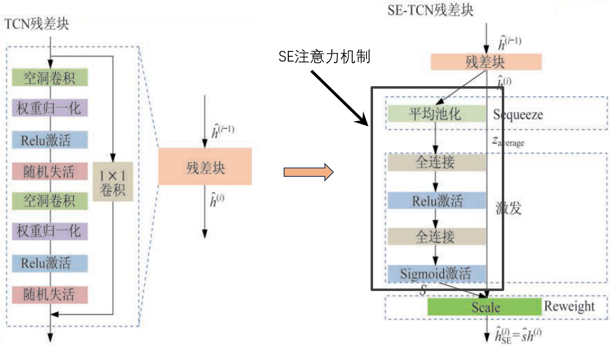
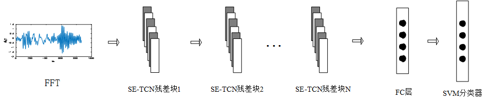
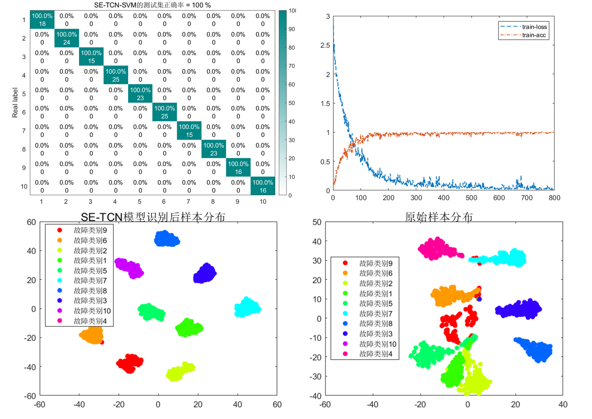
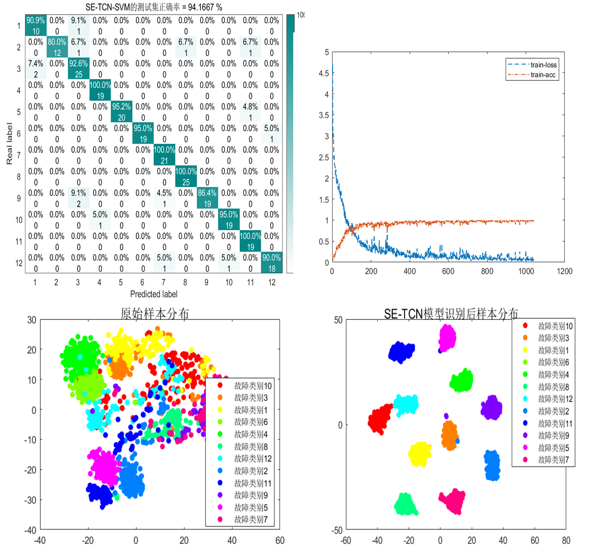
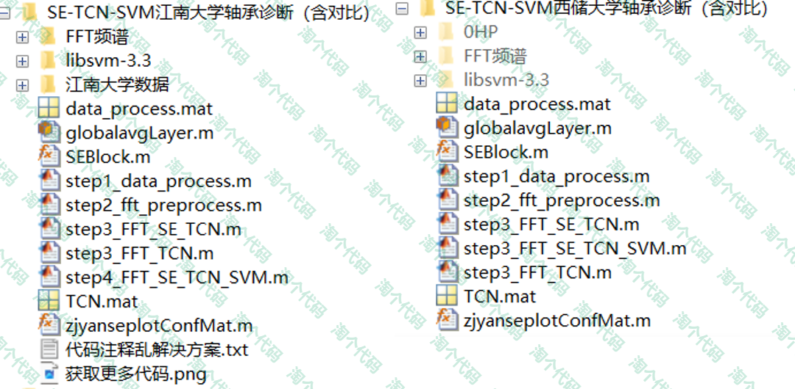

# A small innovation classification model, TCN-SVM model with SE attention mechanism, using bearing data from Jiangnan University and Xichu University as examples---MATLAB code

1. Overview
This period introduces the use of channel attention mechanism in SENet for TCN to enhance its feature extraction capability. This allows the model to selectively focus on channels with critical information when signal morphology changes significantly, thereby strengthening the model's feature expression ability.
To further improve the network's classification capabilities, a classic SVM classifier is used instead of the original Softmax classifier. Tests were conducted on bearing datasets from Xichu University and Jiangnan University, and the results indicate that the proposed SENet-TCN-SVM model has high classification capabilities.
For those interested in machine learning and fault classification, this model can serve as a reference, helping you quickly get started with fault diagnosis.
The TCN network consists of multiple residual blocks stacked together. In this article, an SE module is introduced after each residual block as the attention mechanism for that block. The structure is as follows:
\n        \n  
The overall network flow is as follows:
\n        \n  
First, the bearing data undergoes fast Fourier transform processing, then input into the improved SE-TCN network model, and finally, the SVM classifier replaces the original Softmax classifier to output classification results.
Results Display
1. Results from Xichu University Bearing Data Experiment
Data was divided into 10 fault states under condition 0, collecting 200 samples per state, with each sample size being 1×1024. The training set: validation set: test set ratio was 7:2:1.
FFT-SE-TCN-SVM Model Diagnosis Results on Xichu University Data:
\n        \n  
2. Results from Jiangnan University Bearing Data Experiment
Jiangnan University data included 12 fault states, each collected 200 samples, with each sample size being 1×1024. The training set: validation set: test set ratio was 7:2:1.
FFT-SE-TCN-SVM Model Diagnosis Results on Jiangnan University Bearing Data:
\n        \n  
Note: The actual results are not provided in the text due to the formatting constraints.
Follow the steps in the procedure.
All the images above can be run successfully.
Code directory:
\n        \n  
This code has been added to the full family of fault diagnosis tools!

## Images

<!-- PAYMENT_BLOCK -->

## Get this dataset

- Payment link (Stripe): [Buy now](https://buy.stripe.com/3cs8yP7sY87d0vu9AB)
- Payment QR code: 

<!-- /PAYMENT_BLOCK -->
